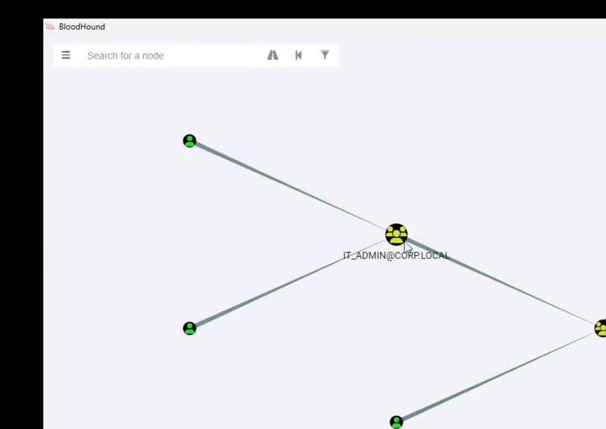
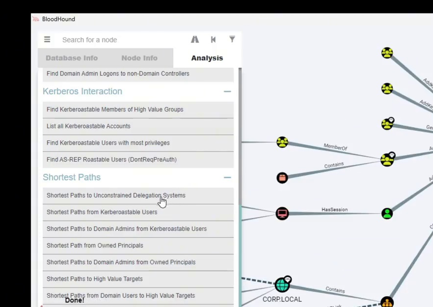
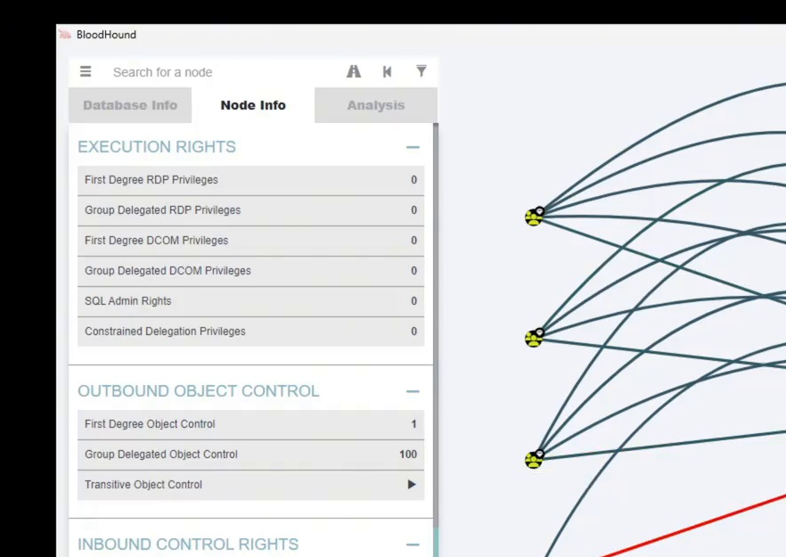
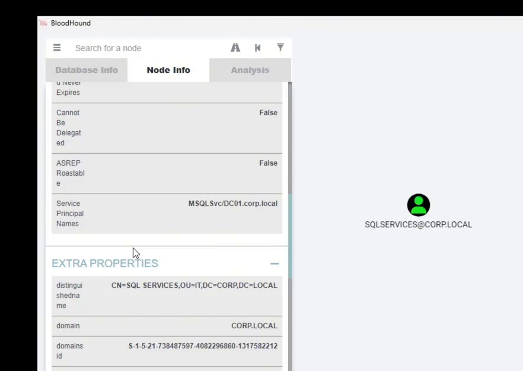
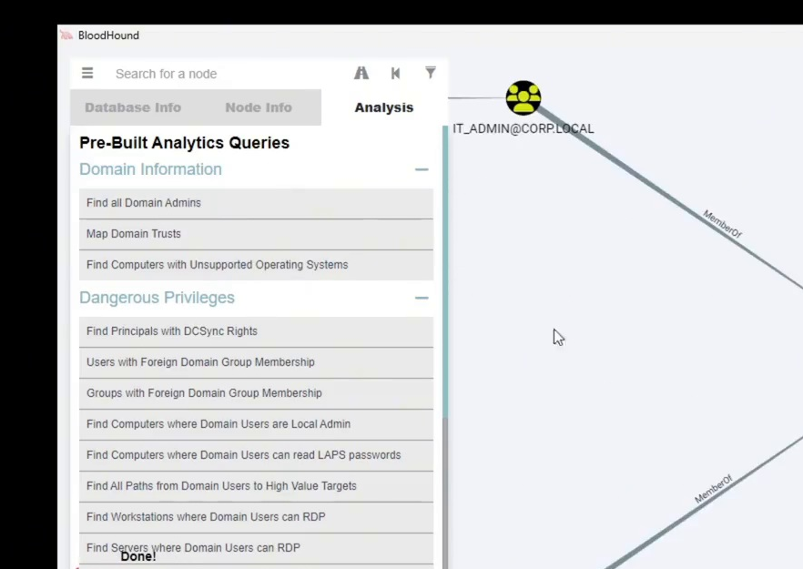
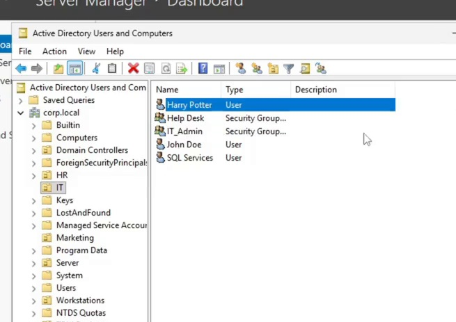
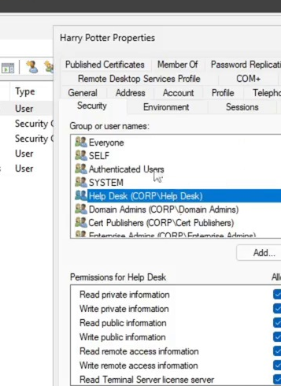
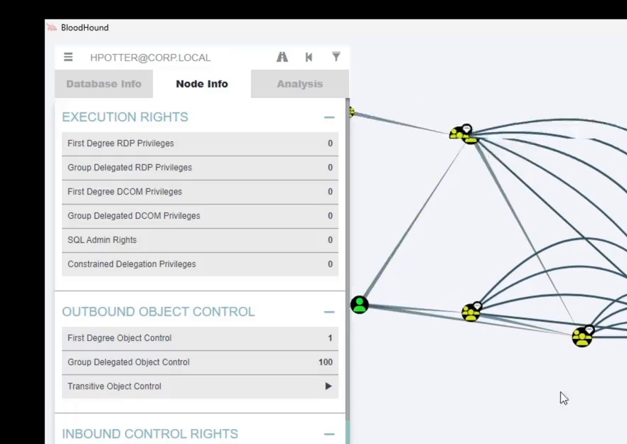
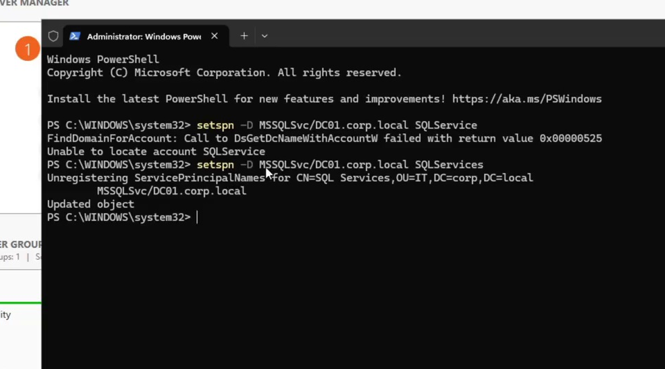
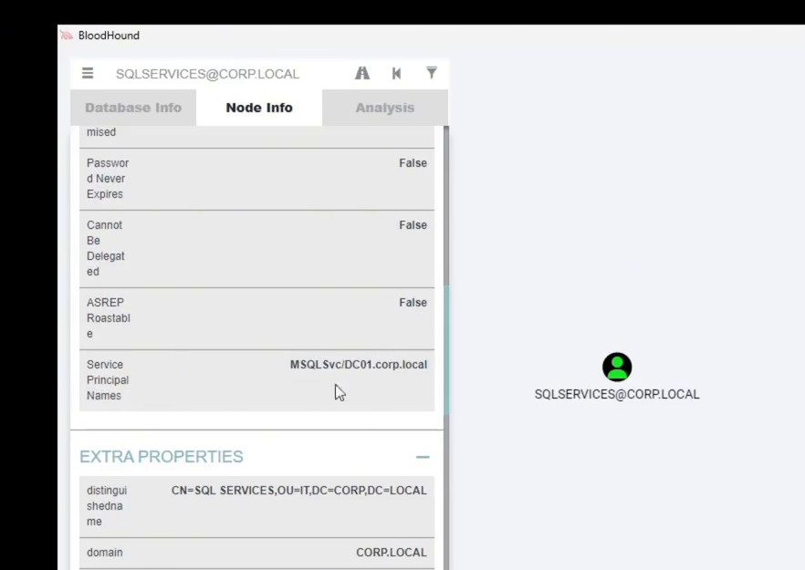

# Active Directory Security Assessment Using BloodHound

## Project Overview

This project was completed to meet the requirements of my Cyber Operations course where I explore how BloodHound can be used to find potential security weaknesses within an Active Directory environment. 
For the project, I build a very small virtual environment using Windows Server 2025 and Windows 11 in VMware for the two virtual machines. For the demonstration I configured users, groups, and intentionally misconfigured permissions in Active Directory to demonstrate common security issues that organizations may encounter. 

The goal was to use BloodHound and SharpHound together and analyze the relationships within Active Directory, discover potential privilege-escalation paths, understand why security weaknesses such as misconfigurations are high risk, and practice remediating them. 

I also wanted to demonstrate how security assessments can be more than just identifying vulnerabilities by showing how changes to permissions and account configurations can reduce security risks.

## Lab Architecture

The environment consist of two machines, Windows Server 2025 domain controller and a Windows 11 workstation in VMware.
The environment used corp.local domain, where I configured users, security groups, and intentionally misconfigured permissions for potential security weaknesses. 

| Machine  | Operating System    | Purpose                                                                                     |
|----------|---------------------|---------------------------------------------------------------------------------------------|
| DC01     | Windows Server 2025 | Domain controller hosting Active Directory Domain Services (AD DS) and DNS                  |
| WIN11-01 | Windows 11          | Domain-joined workstation used for Active Directory security assessment and data collection |

## Assessment Workflow

After the configurations for the Active Directory environment, I used SharpHound to collect information that includes users, groups, permissions, and their relationships.
I imported the SharpHound collected data into BloodHound to create a visual for finding potential privilege-escalation paths and discovering security weaknesses. 
Once that was done, I made changes to the Active Directory configurations and collected the updated data in order to compare the results before and after remediation. 

## Security Findings

1. Excessive Privileged Group Membership

Findings: Identified user accounts that had unnecessary membership in privileged Active Directory groups.

Why It Matters: This increases security risks because if one of those accounts were to be compromised, an attacker can potentially gain administrative access that goes beyond what the user normally requires. 

How I identified It: I used BloodHound to analyze security group memberships and relationships between users and privileged groups. 

**Initial BloodHound Analysis**

2. Excessive Delegated Permissions

Findings: Found unnecessary delegated permissions such as GenericWrite and ForceChanfePassword, this could create potential privilege-escalation paths.  

Why It Matters: These permissions allow accounts to modify properties or reset passwords on other Active Directory objects. If assigned incorrectly, they can potentially allow users to gain access or privileges they should not have.

How I identified It: I analyzed permission relationships and potential attack paths within BloodHound to find accounts with excessive control over other objects. 

**Delegated Rights Analysis**

**Object-Control Relationships**

3. SPM-Enabled Service Account

Findings: Identified an SPN-enabled service account (SQLServices) that presents potential Kerberoasting risk. 

Why It Matters: Kerberoasting allows an authenticated domain user to request service tickets associated with SPN-enabled accounts and can attempt to crack the encrypted ticket content offline. Weak service-account passwords can increase the risk of account compromise.

How I identified It: I examined the service account's Active Directory configuration and its representation in BloodHound to identify the potential security exposure. 

**SQLServices Account Analysis**

## Remediation & Validation 

1. Privileged Group Membership

Remediation: I reviewed Active Directory group memberships and removed the privileged access from accounts that did not need administrative permissions.

Validation: Collected the updated Active Directory data using SharpHound and compared the relationships in BloodHound to verify that the privilege access had been reduced.

**Post-Remediation BloodHound Review**

**Active Directory Account Administration**

2. Excessive Delegated Permissions

Remediation: I modified the delegated permissions in Active Directory, this included permissions regarding GenericWrite and ForceChangePassword, to reduce potential privilege-escalation opportunities. 

Validation: Re-ran SharpHound and reviewed the updated relationships in BloodHound to compare the environment before and after the permission changes.

**Reviewing Account Permissions**

**Post-Remediation Object-Control Review**

3. SPN-Enabled Service Account

Remediation: Used PowerShell to modify the Service Principal Name (SPN) configuration that was associated with the SQLServices account. 

Validation: PowerShell reported that the account was successfully updated. However, the BloodHound review still displayed the SPN. 

**PowerShell SPN Modification**

**SPN Verification — Inconclusive**

## Assessment Results

The assessment demonstrated how BloodHound can help identify potential risk in Active Directory relationships and evaluate changes made to reduce unnecessary permissions.
By comparing the collected data before and after remediation, I was able to see how changes to group memberships and delegated permissions can affect potential privilege-escalation paths.
The project also reinforces the importance of verifying security changes instead of assuming a configuration was successful just because a command completed with no errors.

